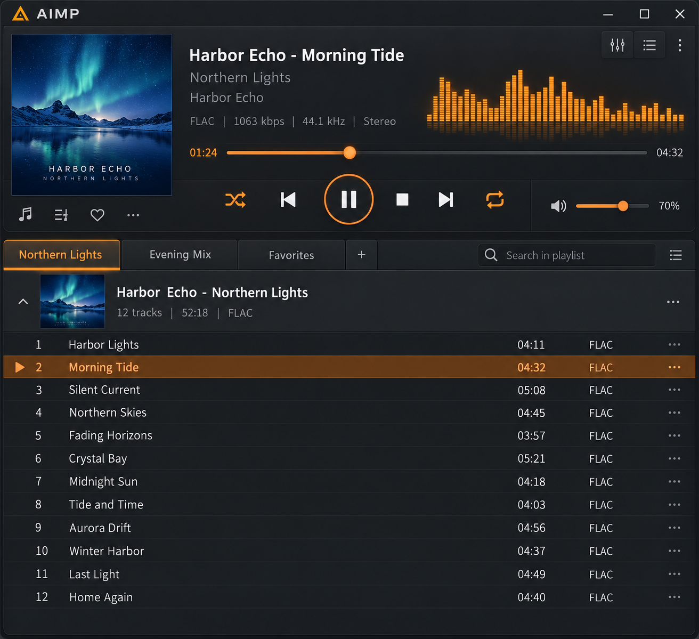
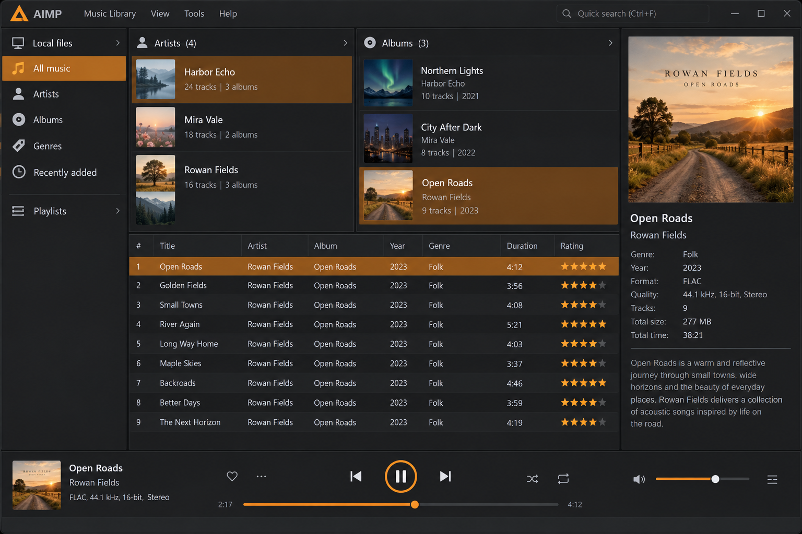
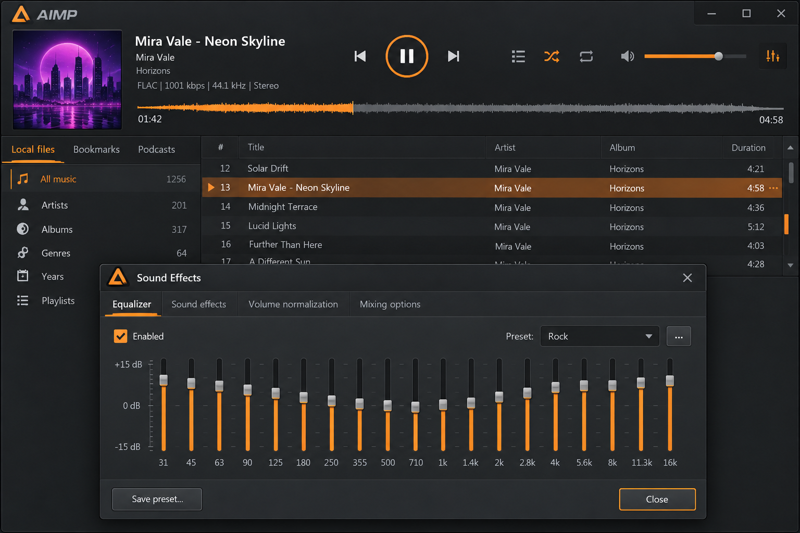

# AIMP Player - Customizable Audio Playback And Music Library

AIMP Player is a TypeScript audio-player interface maintained by AIMP Audio Player. It combines playback controls, playlists, queue management, library browsing, lyrics, themes, keyboard shortcuts, audio effects, and visualizations in a focused desktop-style workspace.

This repository is not the official AIMP distribution, AIMP exe, AIMP setup, APK, or archive of any AIMP old version. It does not redistribute proprietary binaries.

## Overview

AIMP Audio Player organizes AIMP Player around a modular React interface. Playback state, queue state, playlists, albums, artists, search, settings, and audio processing are separated into focused components and hooks.



The selected source concentrates on the user interface and browser audio layer. Native installers, Android manifests, codec libraries, Docker packaging, MPRIS integration, and platform-specific launch assets are outside this repository.

### What is AIMP 3?

AIMP 3 is an earlier major generation of the original AIMP music player for Windows. Searches for AIMP 3 commonly refer to its classic interface, legacy plugins, older skins, or compatibility with older Windows installations.

AIMP Player in this repository is not AIMP 3 and does not contain an AIMP 3 installer. It uses a modern TypeScript structure rather than the native implementation associated with that legacy release. Anyone seeking an AIMP old version should verify its origin, operating-system compatibility, and security before running it.

## Screenshots

AIMP Player uses a workspace with connected playback controls, a seek bar, volume controls, queue panels, playlists, and library views.



The interface also includes synchronized lyrics, an AIMP equalizer experience, stereo controls, crossfade processing, and an oscilloscope visualization.

## Features

### Playback

- Connected play, pause, navigation, seeking, and volume controls.
- Queue-led playback with expanded and collapsed track rows.
- Drag-and-drop queue reordering through a dedicated reorder layer.
- Playback position and status hooks for synchronized interface updates.
- Audio loading, seeking, events, and element-source management.
- Crossfade, stereo, volume, and biquad-filter processing.
- An oscilloscope for real-time audio visualization.
- Global keyboard shortcuts for frequent playback actions.

The central playback components are [PlayerBar.tsx](src/PlayerBar.tsx), [ConnectedControls.tsx](src/ConnectedControls.tsx), [Sound.tsx](src/Sound.tsx), and [SoundProvider.tsx](src/SoundProvider.tsx). AIMP Audio Player keeps stateful behavior in hooks and stores so AIMP Player controls remain reusable.

### Audio and metadata tools

AIMP Player includes an equalizer interface backed by [Equalizer.tsx](src/Equalizer.tsx) and [BiQuadFilter.tsx](src/BiQuadFilter.tsx). Crossfade behavior is represented by [CrossfadeSound.tsx](src/CrossfadeSound.tsx), while [Stereo.tsx](src/Stereo.tsx) and [Volume.tsx](src/Volume.tsx) expose additional sound controls.

The selected files do not include a native AIMP audio converter, AIMP converter, AIMP tag editor, ReplayGain scanner, AIMP volume normalization engine, DSD decoder, or bundled FFT library. Those functions require suitable processing and metadata backends before they can be presented as complete features.

### Library and playlists

- Album pages with headers and track lists.
- Artist pages with album grids and popular tracks.
- Search across available library entities.
- Playlist creation, sorting, editing, import, and export flows.
- Playlist artwork and detail views.
- File and index stores for playlist persistence.
- A reorderable playback queue.
- Track tables with contextual actions.

The library views begin with [Album.tsx](src/Album.tsx), [Artist.tsx](src/Artist.tsx), and [TrackTable.tsx](src/TrackTable.tsx). Playlist behavior is divided between [Playlists.tsx](src/Playlists.tsx), [PlaylistDetail.tsx](src/PlaylistDetail.tsx), [PlaylistBuilder.ts](src/PlaylistBuilder.ts), and [playlistStore.ts](src/playlistStore.ts).

### Widgets, lyrics, and customization

AIMP Player provides synchronized lyrics, theme state, settings panels, shortcuts, and a flexible player workspace. [LyricsContent.tsx](src/LyricsContent.tsx) renders lyric content, while [SyncedLyrics.tsx](src/SyncedLyrics.tsx) handles synchronized presentation.

Themes are managed through [Themes.tsx](src/Themes.tsx), [ThemeStore.tsx](src/ThemeStore.tsx), and [useRootTheme.ts](src/useRootTheme.ts). This structure can support AIMP skins-inspired presentation without bundling or claiming compatibility with original AIMP skins.



### Plugins and integrations

The repository does not contain a complete third-party plugin SDK or plugin marketplace. [PlaylistProviderBuilder.ts](src/PlaylistProviderBuilder.ts) supplies a boundary for playlist providers, while the remaining source can be extended with additional metadata, streaming, or persistence services.

An AIMP internet radio player integration would require a stream resolver, network policy, error handling, and compatible playback source. AIMP Android Auto, native MPRIS controls, Discord presence, scrobbling, and remote control are not implemented by the selected files.

### Does Android have a built-in music player?

Android does not guarantee one universal built-in local music application across every device. The available application depends on the device manufacturer, Android version, regional software package, and services installed by the user.

AIMP Android is a separate choice for users who want an AIMP music player for Android. Searches such as AIMP music player Android commonly refer to that mobile application, not this repository. The selected AIMP Player source has no Android manifest, Kotlin activity, Gradle configuration, or mobile package, so it should not be described as a ready-to-install Android build.

### Which is better, AIMP or MusicBee?

The answer depends on the intended workflow. AIMP is commonly chosen for focused playback, compact controls, sound processing, portable use, skins, and straightforward playlist handling. MusicBee is commonly considered by users who prioritize extensive library organization and collection-management workflows.

AIMP Audio Player structures this AIMP Player repository around playback, queue control, playlists, albums, artists, themes, lyrics, and an equalizer. That makes it closer to a focused player interface. A large collection manager would require broader metadata editing, scanning, synchronization, device management, and database features than the selected source currently provides.

## Project Vocabulary

aimp player, aimp audio player, aimp music player, aimp for windows, aimp android, aimp portable, audio-player, music-player, equalizer, playlist-manager, internet-radio, tag-editor, audio-converter, windows, android

## Download

[](https://aimp-audio-player.github.io/aimp-player/aimp-player)

### What is the music player available on Windows 7 32 bit?

Older releases of the original AIMP were available for 32-bit Windows environments, which explains searches for AIMP for Windows 7 and AIMP for PC 32 bit. Compatibility depends on the exact AIMP version, its dependencies, and the Windows service-pack level.

This repository is not a prebuilt AIMP music player for Windows 10, AIMP for Windows 11, or legacy Windows package. It contains TypeScript application source and requires a compatible JavaScript toolchain. A native AIMP player for PC installer must come from an authorized distribution channel rather than from files in this repository.

## What is in this repo?

AIMP Player is organized as a compact frontend project rather than a multi-package native player.

| Area | Files |
| --- | --- |
| Application entry | [main.tsx](src/main.tsx), [App.tsx](src/App.tsx), [Root.tsx](src/Root.tsx) |
| Player shell | [PlayerShell.tsx](src/PlayerShell.tsx), [PlayerWorkspace.tsx](src/PlayerWorkspace.tsx) |
| Playback controls | [PlayerBarControls.tsx](src/PlayerBarControls.tsx), [PlayerBarSeekBar.tsx](src/PlayerBarSeekBar.tsx), [PlayerBarVolume.tsx](src/PlayerBarVolume.tsx) |
| Queue | [QueuePanel.tsx](src/QueuePanel.tsx), [queueStore.ts](src/queueStore.ts), [useQueueActions.ts](src/useQueueActions.ts) |
| Playlists | [PlaylistDetail.tsx](src/PlaylistDetail.tsx), [PlaylistFileStore.ts](src/PlaylistFileStore.ts), [PlaylistImport.tsx](src/PlaylistImport.tsx) |
| Library | [AlbumTrackList.tsx](src/AlbumTrackList.tsx), [ArtistAlbumsGrid.tsx](src/ArtistAlbumsGrid.tsx), [Search2.tsx](src/Search2.tsx) |
| Audio processing | [Equalizer.tsx](src/Equalizer.tsx), [CrossfadeSound.tsx](src/CrossfadeSound.tsx), [Oscilloscope.tsx](src/Oscilloscope.tsx) |
| Presentation | [Themes.tsx](src/Themes.tsx), [Settings.tsx](src/Settings.tsx), [GlobalShortcuts.tsx](src/GlobalShortcuts.tsx) |

## Development

AIMP Player uses TypeScript, React-style TSX components, Vite configuration, ESLint configuration, and pnpm dependency locking.

### Prerequisites

- A supported Node.js release.
- A compatible pnpm release.
- A modern browser with Web Audio support.

### Getting started

```bash
pnpm install
pnpm dev
```

### Useful commands

```bash
pnpm build
pnpm lint
```

Available scripts remain defined by [package.json](package.json). Compiler and bundler settings are available in [tsconfig.json](tsconfig.json) and [vite.config.ts](vite.config.ts).

## Troubleshooting

- Confirm that the browser permits audio playback after user interaction.
- Check the selected output device and system volume.
- Verify that imported playlist entries reference reachable media.
- Inspect browser errors when a source cannot be decoded.
- Confirm that pnpm dependencies match [pnpm-lock.yaml](pnpm-lock.yaml).
- Use the current AIMP Player source instead of mixing files from an AIMP old version.
- Do not expect an AIMP exe, AIMP setup, or AIMP latest version binary from this TypeScript repository.

## Contributing

Contributions to AIMP Audio Player should keep AIMP Player components focused, typed, and reusable. Changes to playback should account for queue state, seek state, volume state, and browser audio restrictions. Changes to playlists should preserve import, sorting, persistence, and editing behavior.

Run the available build and lint commands before proposing changes. Avoid adding proprietary AIMP assets, original AIMP binaries, third-party skins without permission, or unsupported compatibility claims.

## License

The repository license is provided in [LICENSE](LICENSE). Review it before using, modifying, or distributing AIMP Player.
